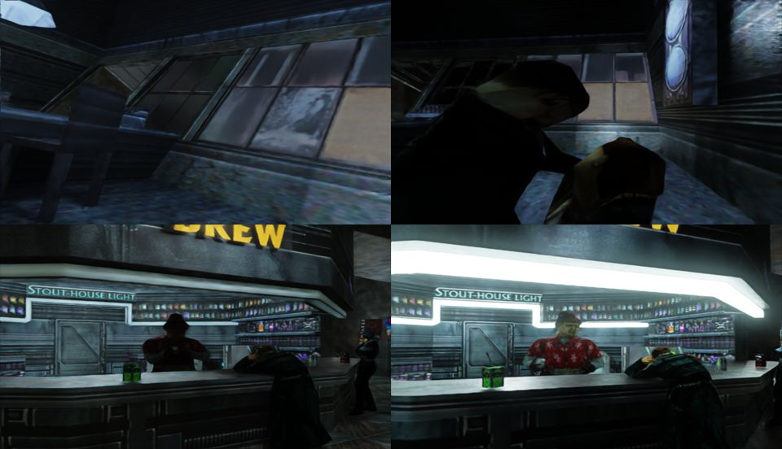

<p align="center">
  
</p>

<h1 align="center">anoxrtx</h1>

<p align="center">
  <strong>Anachronox in RTX Remix – with Linux support, map lights and HD assets.</strong><br>
  A fork of <a href="https://github.com/vinevi1/anoxrtx">vinevi1/anoxrtx</a>.
</p>

<p align="center">
  
  
  
</p>

This project adds a path-traced look to the classic sci-fi RPG **Anachronox**. It is a fork of [vinevi1/anoxrtx](https://github.com/vinevi1/anoxrtx); the upstream project does the heavy lifting, and this fork focuses on Linux, better lighting and higher-resolution assets.

**This is not a standalone game.** You need your own copy of Anachronox, an RTX Remix-compatible NVIDIA RTX GPU, and the game files on the machine where you install the mod. No game data or generated textures are included.

## What this fork adds

- **Linux support** – runs through Steam and Proton, with fixes for `rtx.conf` and the Linux build of [QindieGL](https://github.com/felixarvid2/QindieGL).
- **DLSS / DLAA** under Proton.
- **Map lights from the game's BSP files** – light styles, sun, spotlights, per-map settings and hand overrides, plus the game's dynamic lights.
- **HD skies, liquids and materials** – emissive surfaces, normal maps, roughness and glass for level textures.
- **Support for Chuncki's 4× texture pack**, with texture hashes remapped.
- **HD model textures** and AI-redrawn posters (Real-ESRGAN and FLUX.1).
- **Optional Remix Plus runtime** with a physical sky on outdoor maps and replaceable lava.
- **Tools** for reading ADAT/BSP data, generating texture hashes and map lights, and testing captures.

## Requirements

- **Anachronox** on Steam.
- An **NVIDIA RTX GPU** supported by RTX Remix.
- **Linux** with Steam and Proton (the main target for this fork). Windows users can start from the upstream project.
- Python 3 and `git` for the installer.

## Install

```bash
git clone https://github.com/felixarvid2/anoxrtx
cd anoxrtx
tools/install.sh --steam
```

The installer creates a Python environment, builds QindieGL, downloads and configures the RTX Remix runtime, and generates map lights and assets from your own game files.

To use Chuncki's 4× texture pack as well:

```bash
tools/install.sh --chuncki /path/to/Chunckis_4x_AI_upscaled_Anachronox_textures.zip --steam
```

Run `tools/install.sh --help` for all options, including the Remix Plus runtime and an existing QindieGL build.

## Documentation

- [Documentation map](docs/README.md)
- [Current status and coverage](STATUS.md)
- [Troubleshooting](docs/TROUBLESHOOTING.md)
- [Architecture](docs/ARCHITECTURE.md)
- [Screenshot regression workflow](docs/screenshot-regression.md)

## Credits

Thanks to **vinevi1** for the original anoxrtx project, to the RTX Remix and Remix Plus communities, and to **Chuncki** for the 4× texture pack. QindieGL, Anachronox and all third-party assets remain under their original licenses.
