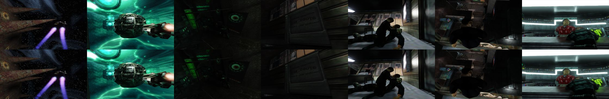
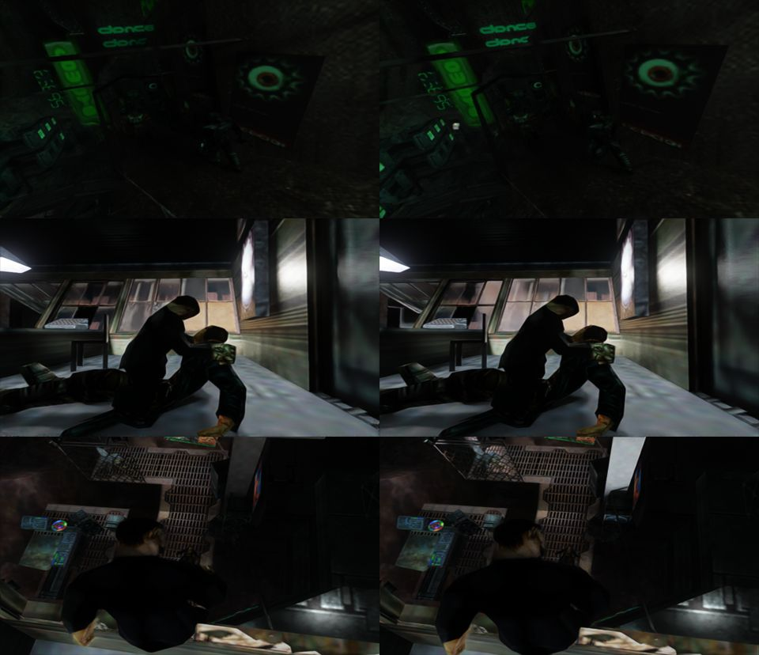
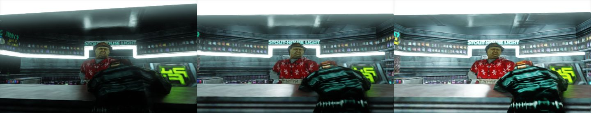
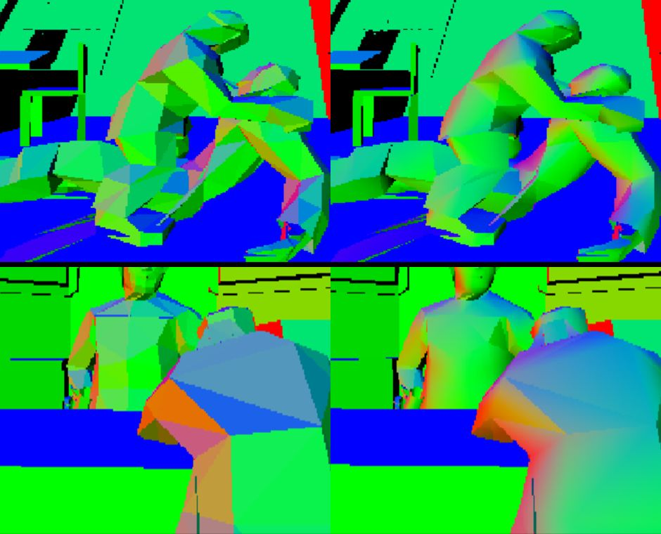
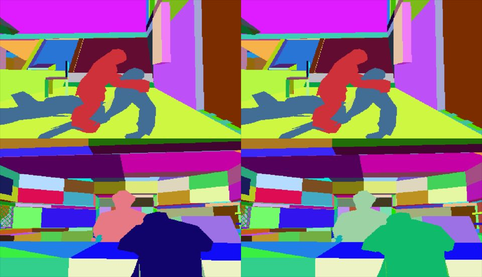
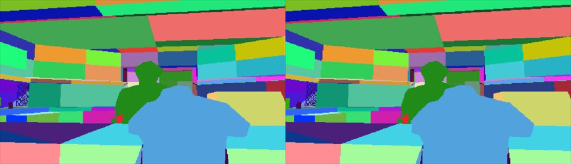
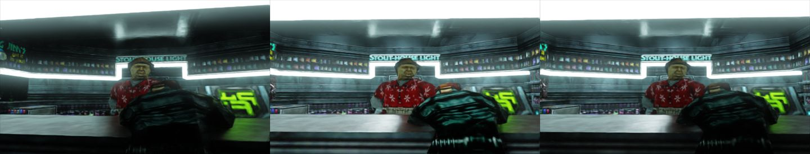
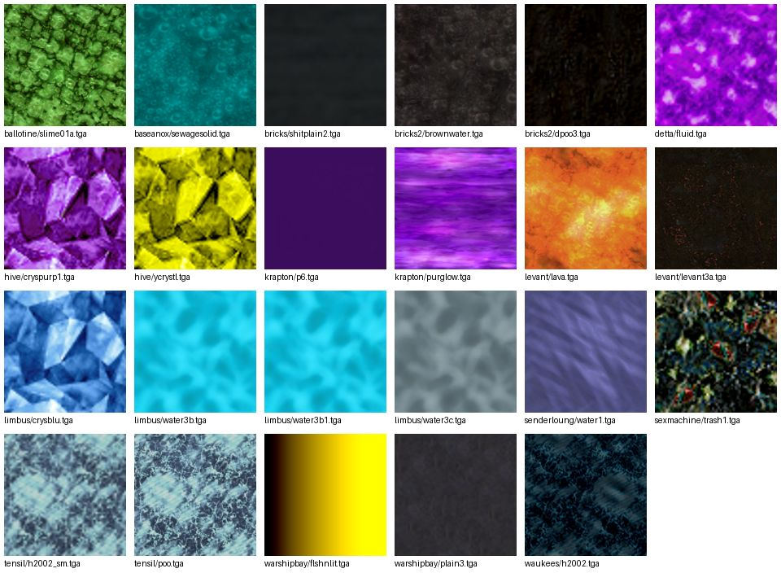

# Resultat: fas 0–3 i PLAN.md

De ursprungliga testerna i fas 0–3 är gjorda på Linux (GE-Proton 11-9, RTX 5060, Remix 1.5.2 release) i en nästlad
`Xwayland :7` med testriggen `tools/anoxrig.py`.

## Uppföljning 2026-10-17: två fasta Rowdy's-vyer

Nuvarande Remix Plus-installation testades med två sparplatser, upprepade baslinjer och separata
diagnostikvarianter. 14 verifierade laddningar gav 42 jämförelsebilder; ytterligare sex bilder
kontrollerade kartljusskala efter laddning. Se [metod och resultat](docs/rowdys-material-check.md).

- Utan genererade normalreferenser blir väggar och golv plattare; ljusa armaturytor finns kvar.
- Avstängd emission på fem skyltmaterial gör skyltarna mörkare. Behåll materialens standardvärden;
  närbilder av misstänkta ljusa kanter och andra miljöer återstår.
- Kartljusskala 1, 0,75 och 0 gav ingen tydlig rumsljusskillnad i dessa vyer, trots bekräftade
  loggvärden. Även omladdning av skalan efter sparladdning prövades. Undersök API-ljusens faktiska
  rendering innan fortsatt kalibrering; resultatet bevisar inte att alla kartljus saknar effekt.
- Testriggens konsolinmatning tappade tecken med den gamla takten. 80 ms tangenttryck och 40 ms
  mellanrum klarade de 14 laddningarna; 26 befintliga tester passerade. Inga ljusstandarder ändrades.
- Återställningsvakten rapporterade återställda filer och Steam-inställningar. Den separata
  slutkontrollen blockerades först av automatisk godkännandegransknings kontogräns. Uppföljningen
  samma dag verifierade fem återställda spelfiler, fem oförändrade sparfiler, återställda
  Steam-startalternativ och stängd X7.

## Uppföljning samma dag: kartljusens identiteter

En riktad [API-kontroll](docs/maplight-api-check.md) hittade en fungerande reproduktion:
ett nytt rött testljus syntes, men samma egenskaper på ett befintligt ljus syntes inte efter
omladdning. API-anropen rapporterade framgång i båda fallen. QindieGL återanvände förstörda
ljusidentiteter; nya identiteter per skapande rättar den observerade livscykeln i Remix Plus 1.5.1.

Efter rättningen gav skalorna 0/100/1 tydliga bildskillnader i samma startkorridor, och återgång
till standardvärdet samt omladdning med samma värde fungerade. Linux-bygget passerade och
exporterade 385 funktioner. Inga ljusstandarder ändrades. De två sparvyerna, andra banor,
animerade stilar, stridsljus, stock Remix och MSVC behöver sina separata kontroller.

## Testmetod (fas 0)

- `anoxrig.py timeline PFX 60 90 120 150 180 240` startar ett nytt spel (New Universe → Normal) och tar
  bilder ett fast antal sekunder efter klicket, utan att hoppa över något. Öppningsfilmen är tidsstyrd,
  så **samma tidpunkt ger samma scen** varje gång (två körningar skiljer bara 1–4 i medelvärde per pixel,
  upp till ~10 där kameran rör sig snabbt). Scenerna täcker rymden, staden, gränden, Boots-scenen och
  Rowdy's bar.

  

- Upptäckter om spelet som riggen behöver:
  - Introt stannar på svart bild tills man trycker **Esc**.
  - Menyerna läser musen **relativt** (Quake 2-stil: `GetCursorPos` mot fönstrets mitt + `SetCursorPos`),
    så klick görs med relativa rörelser (`move`, `press`). `BorderlessFullscreen` fungerar därför med musen
    utan extra skalning; grenen `borderless-mouse` i QindieGL behövs inte.
  - Konsolen gick inte att öppna (varken `` ` `` eller tangentkod 49, med `+set console 1`).
  - `+map` från kommandoraden laddar inte en bana (utan Remix: titelskärm; med Remix: fastnar på
    "One moment......").
  - Sparning går bara vid TimeMinders; det fanns inga sparfiler, därför används öppningsfilmen som testbana.

## Fas 1: konfig

| Variant | Ändring | Resultat |
|---|---|---|
| v1 | QindieGL `[game.anox]`: `orthoskipuntextureddraws = 1`, `depthOffDisablesWrites = 1` | Ingen skillnad utöver brus i testscenerna |
| v2 | `r_novis 1`, `gl_dynamic 0`, `gl_flashblend 0`, `gl_polyblend 0` | Ingen tydlig kvalitetsskillnad (bilderna förskjuts lite i tid) |
| v3 | `cl_distancecull 0`, `cl_noheadcull 1`, `cl_weathercull 0` | Ingen skillnad utöver brus |
| v5 | `rtx.suppressLightKeeping = True`, `rtx.sceneScale = 0.4` | Ingen tydlig skillnad |

Inget av detta infördes som standard, eftersom det inte syntes någon förbättring. Variablerna kan
fortfarande spela roll i spelbanor med mer rörelse och dynamiska ljus (inte testat).

## Fas 2: ljus

- **v4, reservljus** (`rtx.fallbackLightMode = 2`): mörka scener blir något ljusare (gränden, neonskylten).
  Ett fast riktat ljus kan se fel ut inomhus, så det ligger **avstängt som kommentar** i `rtx.conf`.

  

- **Spelets dynamiska ljus som Remix-ljus** (`flashblendlights`, QindieGL-gren `flashblend-lights`):
  QindieGL känner igen Quake 2:s "flashblend"-ritning av dynamiska ljus (additiv triangelfläkt med färgat
  centrum och svart kant) och lägger in ett Remix-ljus i stället via Remix API. Byggt och Remix API startar,
  men öppningsfilmen har inga dynamiska ljus, så **funktionen är inte prövad**. Avstängd som standard.
  Testa i en bana med strid/explosioner med `gl_flashblend 1`, `remixapi = 1`, `flashblendlights = 1` och
  `exposeRemixApi = True` i `.trex/bridge.conf`; loggen visar `flashblend light #N` när den slår till.
- **Ljus ur banfilerna** (`maplights`, QindieGL-gren `maplights`): fungerar.
  - `tools/adat.py` packar upp spelets ADAT-arkiv (format från hogsy/chronon); `tools/bspinfo.py` läser
    ljus, himmel och vätskeytor ur BSP-filerna (16 068 `light` i 97 av 98 banor, 21 skyboxar i
    `GRAPHICS.dat` `sky\`, 27 vätsketexturer); `tools/bsp2lights.py` skriver en `.lights`-fil per bana.
  - Ljus i `mod.usda` under `/RootNode/lights` fungerar **inte**: Remix (1.5.2, `rtx_mod_usd.cpp`) läser
    dem bara som ersättning av spelets egna ljus. En Remix-fångst för att hitta en ankarmesh gick inte att
    starta från riggen (Remix får inga syntetiska tangenttryck), så ljusen läggs in via Remix API i stället:
    QindieGL fångar `ref_gl.dll!ref_SetMapName`, läser `rtx-remix/maplights/<bana>.lights` och ritar
    ljusen varje bildruta. Kräver `remixapi = 1`, `maplights = 1` i `[game.anox]` och
    `exposeRemixApi = True` i `.trex/bridge.conf`.
  - Rowdy's (71 ljus), vänster utan, mitten `maplights_scale = 100`, höger 1000:

    

## Fas 3: geometri

- **Mjuka normaler** (`smoothnormals = 1`, QindieGL-gren `smooth-normals`): QindieGL räknar ut mjuka
  normaler för modeller/figurer (inte världen). Anachronox ritar hela modeller i ett anrop (triangellistor,
  ~540 hörn), så utjämningen gäller hela modellen. Remix debug-vy *Shading Normal* (index 16 i 1.5.2):

  

  Med detta behövs inte längre tricket med maxad roughness/metalness på figurer för att dölja kanterna.
- **Stabila hashar**: debug-vy *Geometry Hash* (277). Världens hashar är identiska mellan körningar.
  Figurer byter hash i varje animationsbildruta (vänster/höger nedan: bartendern och Boots har olika färg):

  

  Med `rtx.geometryAssetHashRuleString = indices,texcoords,geometrydescriptor` (positioner utelämnade)
  får figurerna samma hash hela tiden, så deras geometri kan bytas ut. Infört i `rtx.conf`.

  

- **Himmel och filmkamera**: inte undersökt närmare. Remix hittar kameran i alla filmscener i testerna
  (`Camera cut detected` vid varje klipp, inga `rejected an invalid camera` efter starten).

## Kvar att göra

- Testa `flashblendlights` i en bana med dynamiska ljus.
- Prova fas 1-variablerna i spelbanor (inte bara öppningsfilmen).
- Himmel (skyboxarna är 256x256: uppskalning/utbyte), vatten (27 vätsketexturer -> Remix-material), partiklar.
- Finjustera kartljusens styrka/radie per ljustyp (`falloff`, `cap`, `_cone` används inte än).

## Uppföljning: ljusnycklar, himmel och vatten

### Kartljus: `cap`, `falloff`, `_cone`
Anachronox ljusnycklar är inte dokumenterade någonstans (ArghRad har `_cap` = tak för ljusstyrkan;
hogsy/chronon: "_cone ... size of light for spotlights", standard 10). `tools/bsp2lights.py` använder nu en
tumregel: styrka = min(`light`, `cap`) / clamp(`falloff`, 0.25, 4); `_cone` med känd riktning (mot `target`
eller från `angle`/`angles`) blir spotljus (145 st i spelet). QindieGL:s `maplights` läser riktning + konvinkel
(valfria fält 9–12) och sätter Remix-shaping. Resultat i Rowdy's: något mörkare, samma ljusfördelning
(vänster utan kartljus, mitten råa värden, höger tumregeln):

### Texturhashar utan Remix-fångst
- QindieGL `DumpTextures = 1` (gren `texdump`) räknar Remix texturhash (XXH3_64 av mip 0 i D3D-format,
  som i dxvk-remix `d3d9_common_texture.cpp`) och sparar bilden som `<hash>.tga`. Kontroll: vinevi1:s hashar
  i `rtx.conf` finns i dumpen (51 UI, 26 dekaler, 15 himmel, …).
- Dumpade bilder är exakt originalfilerna, så `tools/remixhash.py` räknar hashen direkt från spelets
  bildfiler (BGRA, alfa 255 utan alfakanal). Kontroll: 49 av vinevi1:s 53 himmelshashar.
- `rtx.skyBoxTextures` utökad från 53 till 103 (alla himmelssidor), så Remix känner igen fler himlar.

### Himmel
21 skyboxar i `GRAPHICS.dat` `sky\` (111 sidor 256×256, 15 platshållare 16×16). Uppskalade ×4 med
Real-ESRGAN (realesrgan-ncnn-vulkan). Stjärnhimlar blev **sämre** (stjärnorna försvinner), så bara ljusa
himlar ersätts: 62 sidor från 14 himlar (sunder, blue, forest, home, outside, …) i `hd_sky.usda`
(DXT1 med mipmaps). Introt visar bara stjärnhimlar, så de ersatta himlarna är inte sedda i spelet än.

### Vatten och andra vätskor
25 vätsketexturer (`SURF_WARP`) i banorna; 23 går att hasha (2 `proc_lava*` genereras medan spelet kör).
`liquids.usda` ger material efter typ: vatten genomskinligt (`AperturePBR_Translucent`, IOR 1.33),
slem/avlopp blankt, lava och kristaller självlysande. Uppskalade ×4. Laddas av Remix (loggen), men
**inte sett i spelet**: vätskorna finns först i senare banor (Limbus, Levant, Hive, …).

Bygga lokalt (speldata committas inte): `tools/adat.py extract … 'sky*'` och vätsketexturerna ur
TEXTURES.dat, uppskala till PNG, sedan `tools/make_layers.py <mod> --sky-src … --sky-hd … --liq-src … --liq-hd …`
och lägg `subLayers = [@./hd_sky.usda@, @./liquids.usda@]` i `mod.usda`.
